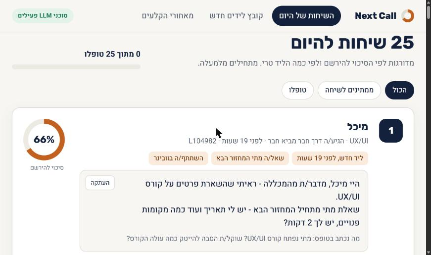
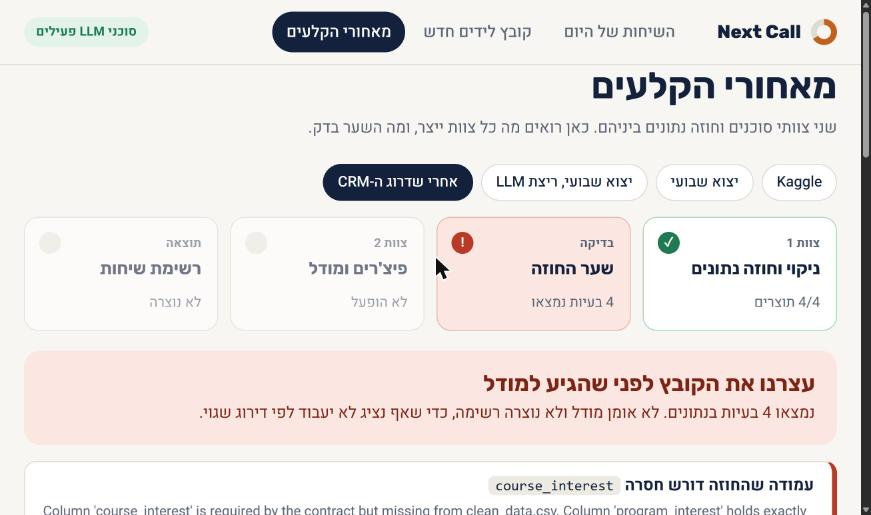
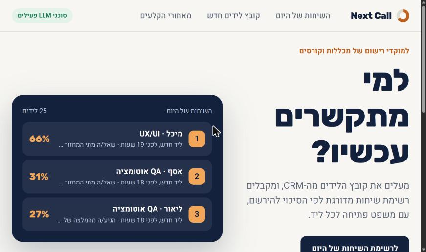
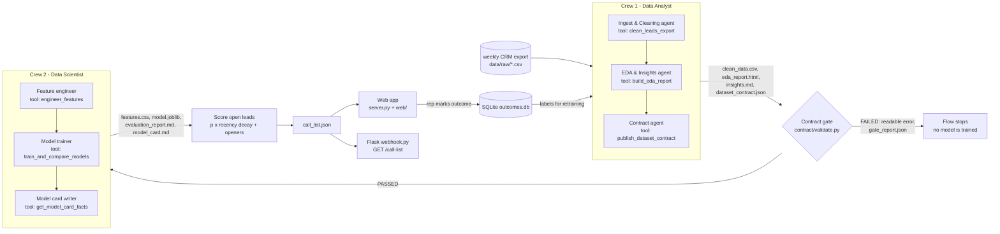

# Next Call

**A CrewAI Flow where two agent crews work as one team, with a data contract between them that the machine enforces.**
Final project, AI Developers course (cohort 13). Brief: "Industry-Simulated AI Product Workflow" (Harbor & Vale).

The product story: an admissions rep at a vocational college gets hundreds of leads a month and calls them in arrival
order, while a hot lead goes cold within 48 hours. Next Call gives the rep a ranked call list every morning, with two
opening lines per lead. The engineering story, and the real point of the project, is the **seam** between the crews:
a contract one crew publishes and the other must honour, and a Flow that stops with a readable message when they disagree.

| Today's calls | A broken file is stopped |
|---|---|
|  |  |

## The app

```bash
python server.py        # http://127.0.0.1:8000
```

A Flask API (`server.py`) with a plain HTML/CSS/JS front end (`web/`), in Hebrew, built for the rep:

- **Today's calls** - the ranked list, why each lead is on it, an opening line to copy, one click to mark what happened.
- **New leads file** - drop a CSV (or pick a sample), watch the four stages run live, get a list or a plain explanation
  of why the file was stopped.
- **Behind the scenes** - every run with its 8 artifacts, the model comparison, the Flow log, and a one-click
  "change a unit" test that makes the gate refuse the handoff.



## How it works



- `flow.py` - the CrewAI Flow: `@start` prepare → `@listen` analyst_crew → `@router` contract_gate →
  `"gate_passed"` scientist_crew → call_list, or `"gate_failed"` stop.
- `crews/analyst/`, `crews/scientist/` - 3 agents each. Every agent owns one deterministic pandas / scikit-learn tool
  (`tools/`). The LLM orchestrates and writes the narrative parts; **the numbers always come from the tools**.
- `contract/spec.py` - the analysts' declared semantics (names, types, allowed values, units, plausible ranges). It is
  versioned code, so the contract cannot silently "adapt" to broken data.
- `contract/validate.py` - the gate. Plain pandas, reports **all** problems at once, with rename and unit hints.
- Crew 2's tools only receive `crew1/clean_data.csv` and `crew1/dataset_contract.json`. Its context has no raw path.
- **Two dataset profiles**, each with its own contract spec and cleaning tool, same gate and same Flow:
  `synthetic` (a college CRM export, `contract/spec.py`) and `kaggle` (the real
  [Lead Scoring Dataset](https://www.kaggle.com/datasets/amritachatterjee09/lead-scoring-dataset), `contract/spec_kaggle.py`).
- Every run writes `artifacts/<input name>/`: `crew1/*`, `crew2/*`, `call_list.json`, `gate_report.json`, `flow.log`,
  `run_summary.json`. The artifacts of the reference runs are committed.

## Quick start

Python 3.12.

```bash
git clone https://github.com/ethanmuli-collab/next-call.git
cd next-call
python -m venv .venv
.venv\Scripts\activate            # Windows   (macOS/Linux: source .venv/bin/activate)
pip install -r requirements.txt

python flow.py                                             # full Flow: 8 artifacts + call list
python flow.py --input data/raw/leads_weekly_export_v2.csv # broken export: the gate stops the Flow
python server.py                                           # the web app: http://127.0.0.1:8000
```

The synthetic exports in `data/raw/` are generated on the first run (fixed seed), so no download is needed.

**Real data (optional):** download the Kaggle
[Lead Scoring Dataset](https://www.kaggle.com/datasets/amritachatterjee09/lead-scoring-dataset) and put
`Lead Scoring.csv` in `data/kaggle/`. Then:

```bash
python flow.py --dataset kaggle          # 9,240 real leads -> artifacts/kaggle_lead_scoring/
```

The app shows the Kaggle option as soon as the file is there. The dataset's licence is not stated on Kaggle, so the
raw file, `clean_data.csv` and `features.csv` of this profile stay local (git-ignored); the reports, the contract,
the model and the run summary are committed.
Without an API key everything runs in **offline mode** (see below). For LLM mode copy `env.example` to `.env` and set
`OPENAI_API_KEY`.

Other commands:

```bash
python flow.py --from-handoff            # skip Crew 1, re-validate the existing clean_data.csv, then model
python flow.py --run-dir artifacts/my_run  # write the artifacts somewhere else
python -m unittest -v                    # 14 unit tests: the contract gate (both profiles) and the web API
streamlit run app.py                     # the same Flow in a Streamlit console (English)
python smoke_test.py                     # end to end, offline, outbound network blocked
python webhook.py                        # Flask: http://127.0.0.1:5055/call-list?top=20
```

## Break it on purpose

A validation you have never seen fail is untested code. Three ways to watch the gate stop the Flow:

1. **Broken weekly export** (`leads_weekly_export_v2.csv`): `course_interest` was renamed to `program_interest` and
   `response_time_min` silently switched to seconds.
   ```
   Contract gate FAILED - 4 problem(s); Crew 2 (modeling) was NOT started.
     1. [missing_column] Column 'course_interest' is required by the contract but missing from clean_data.csv.
        Column 'program_interest' holds exactly the allowed values of 'course_interest' - it looks renamed.
     2. [range] Column 'response_time_min' has 2567 values (52.0%) outside the declared range [0, 10080] minutes ...
     3. [unit] Column 'response_time_min' median is 10740, outside the expected 30-900 minutes ...
        the unit looks like it changed from minutes to seconds.
     4. [model_features] Required model features missing before modeling: ['course_interest'].
   ```
2. **Change one unit in the clean data** (the brief's Monday-morning scenario). In the app press
   *Break it on purpose*: it turns minutes into hours in `crew1/clean_data.csv`, keeps the column name, and re-runs
   from the handoff. The gate refuses to train. By hand: edit the CSV, then `python flow.py --from-handoff`.
   Run the Flow normally afterwards to restore the clean data.
3. **Kaggle profile:** the same button divides `time_on_site_sec` by 60 (seconds → minutes). The median drops from
   248 to 4, outside the contract's 100-700 seconds, and the gate stops the Flow.
4. **Unit tests** (10) cover: renamed column, minutes → seconds, seconds → minutes, out-of-range value, unknown
   category, the `Select` form placeholder leaking through, a leakage column coming back, and a contract with a
   column spec deleted.

## Mapping to the brief

| Requirement | Where |
|---|---|
| CrewAI Flow coordinating two crews | `flow.py` (`NextCallFlow`, `@start` / `@listen` / `@router`) |
| Crew 1, at least 3 agents | `crews/analyst/crew.py` (cleaning, EDA, contract agents) |
| `clean_data.csv`, `eda_report.html`, `insights.md`, `dataset_contract.json` | `tools/cleaning.py`, `tools/eda.py`, `tools/contract_tools.py` → `artifacts/<run>/crew1/` |
| Crew 2, at least 3 agents, reads only contract + clean data | `crews/scientist/crew.py` (feature engineer, trainer, model card writer) |
| `features.csv`, `model.joblib`, `evaluation_report.md` (2+ variations), `model_card.md` | `tools/features.py`, `tools/modeling.py` (logistic regression vs HistGradientBoosting vs arrival-order baseline), `tools/model_card.py` → `artifacts/<run>/crew2/` |
| Validate contract vs data; required features exist before modeling | `contract/validate.py`: schema, dtypes, allowed values, ranges, units, nulls, key uniqueness, row count, target rate, model features, contract structure, fingerprint |
| Deterministic, logged, artifacts in the repo | fixed seeds, time-based split, `as_of` taken from the data and not the clock; `flow.log`, `gate_report.json`, `run_summary.json`; the smoke test checks byte-identical reruns |
| Fail gracefully with a readable message | `contract_gate` router → `stop`; shown in the CLI (exit code 1), the web app, the Streamlit console and the webhook (HTTP 409) |
| Streamlit or Flask, front end in HTML + CSS | `server.py` (Flask API) + `web/` (HTML, CSS, JS); also `app.py` (Streamlit) and `webhook.py` (n8n endpoints) |
| Secrets out of the repo | `.env` via python-dotenv, `env.example`, `.gitignore` (`.env`, raw data, `*.db`, venvs) |
| Git + GitHub with Pull Requests | one branch and one PR per task, see the [PR history](https://github.com/ethanmuli-collab/next-call/pulls?q=is%3Apr) |

Project docs: [`docs/SPEC.md`](docs/SPEC.md) (specification), [`docs/PLAN.md`](docs/PLAN.md) (task table with the
actual check result of every task; Hebrew).

## LLM mode vs offline mode

| Part | With `OPENAI_API_KEY` | Offline (no key) |
|---|---|---|
| Cleaning, EDA numbers, contract, gate, features, models, scores | same deterministic tools | same deterministic tools |
| Who calls the tools | CrewAI agents (sequential crews) | the Flow calls each agent's own tool directly, in task order |
| Insights, evaluation commentary, model card sections | written by the agents from tool output | templates filled from the same facts |
| Call openers | one `gpt-4o-mini` JSON call for the list | Hebrew templates keyed on form-text cues |
| Badge in the app | "LLM mode" | "OFFLINE mode (no LLM)" |

Both modes were run on the same export and are committed: `artifacts/leads_weekly_export/` (offline) and
`artifacts/leads_weekly_export_llm/` (LLM, `gpt-4o-mini`). The metrics in the two `run_summary.json` files are identical;
only the wording of the narratives and the call openers differs.

If the LLM fails mid-run (network, quota), the Flow logs a warning and falls back to the offline path for that step.
`NEXT_CALL_OFFLINE=1` forces offline mode.

## Results

**Kaggle Lead Scoring (real data).** 9,240 leads, 38.5% converted. Stratified 80/20 split with a fixed seed (the
dataset has no timestamp), 1,848 test leads. Columns the sales team fills in after contact (`Tags`, `Lead Quality`,
`Lead Profile`, `Last Activity`) are dropped as leakage, so the scores are lower than in notebooks that keep them.

| Model | ROC-AUC | PR-AUC | Conversions reached in the top 20% |
|---|---|---|---|
| HistGradientBoosting (selected) | 0.884 | 0.836 | 45% |
| Logistic regression | 0.872 | 0.820 | 45% |
| Baseline: list order | - | - | 20% |

With a 38.5% base rate the top 20% of a list can hold at most 52% of the conversions, so 45% is close to the ceiling;
96% of the leads in the top 10% converted.

**Synthetic college CRM (reference run, offline).** Time-based holdout of the 972 newest closed leads:

| Model | ROC-AUC | PR-AUC | Enrolments reached in the top 20% |
|---|---|---|---|
| Logistic regression (selected) | 0.793 | 0.392 | 54% |
| HistGradientBoosting | 0.742 | 0.327 | 50% |
| Baseline: arrival order | - | - | 22% |

## Limitations

- **The call list runs on synthetic data.** Those leads are generated with a known signal (speed to lead, webinar,
  referrals, intent words) plus noise, because the public Kaggle file has no timestamps, no free text and no open
  leads. The synthetic metrics describe the pipeline, not a real market; the Kaggle metrics are the real ones.
- The Kaggle holdout is a random split (no time column), which can look better than true future performance.
- Text features are keyword flags, not a language model. `response_time_min` is partly rep-controlled and is imputed
  for leads nobody called yet.
- Age band and region are model features. See the fairness notes in `model_card.md`; the score only orders calls, it
  never removes a lead from the list.
- Single-user SQLite feedback store, no authentication on the apps (the web app binds to 127.0.0.1 and runs one Flow at a time), and Flask `POST /run` is protected only by
  an optional `WEBHOOK_TOKEN`.
- Optional extras that are in the repo but outside the core demo: `n8n/morning_call_list.json` (a morning workflow that
  calls the Flask endpoint).
