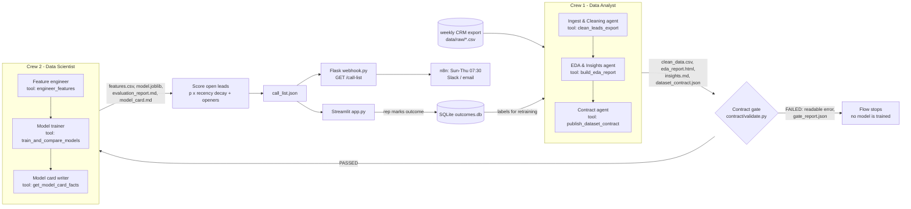

# Next Call - רשימת השיחות היומית של נציג/ת הרשמה

**למי:** נציג/ת הרשמה ומכירות במכללה להכשרות מקצועיות, שמקבל/ת מאות לידים בחודש מטפסי פייסבוק/גוגל ומוובינרים.
**הבעיה:** מתקשרים ללידים לפי סדר ההגעה. ליד חם מתקרר תוך 48 שעות, ואף אחד לא יודע למי להתקשר קודם היום ומה להגיד.

**איך זה עובד:**
- **צוות 1 (אנליסטים, CrewAI):** מנקה את קובץ הלידים השבועי, מפיק דוח EDA ותובנות, ומפרסם **חוזה נתונים** (`dataset_contract.json`).
- **שער ולידציה:** ה-Flow בודק את הנתונים מול החוזה (עמודות, טיפוסים, ערכים מותרים, טווחים, יחידות, ספי null) - ואם משהו נשבר (עמודה ששונה לה השם, דקות שהפכו לשניות) הוא **עוצר עם הודעה קריאה** לפני שמאמנים מודל.
- **צוות 2 (דאטה סיינטיסטים, CrewAI):** קורא רק את החוזה והנתונים הנקיים, בונה פיצ'רים, משווה רגרסיה לוגיסטית מול Gradient Boosting בפיצול לפי זמן, וכותב model card.
- **רשימת השיחות של היום:** ניקוד לידים פתוחים = הסתברות הרשמה x דעיכה לפי גיל הליד (זמן מחצית 48 שעות), עם 2 שורות פתיחה מותאמות אישית לפי מה שהליד כתב בטופס (LLM, או תבנית במצב offline).
- **ממשק ואוטומציה:** אפליקציית Streamlit (הרצה, תוצרים, רשימת שיחות וסימון תוצאה שנשמרת לאימון הבא) + endpoint ב-Flask ו-workflow של n8n ששולח את הרשימה כל בוקר ל-Slack/מייל.

---

## Architecture



- `flow.py` - the CrewAI Flow (`@start` prepare -> `@listen` analyst_crew -> `@router` contract_gate -> `"gate_passed"` scientist_crew -> call_list, or `"gate_failed"` stop).
- `crews/analyst/`, `crews/scientist/` - 3 agents each; every agent owns one deterministic pandas/sklearn tool (`tools/`). The LLM orchestrates and writes the narrative parts; the numbers always come from the tools.
- `contract/spec.py` - the analysts' declared semantics (names, types, allowed values, units, plausible ranges). It is versioned code, so a contract can't silently "adapt" to broken data. `contract/validate.py` - the gate, plain pandas, reports **all** problems at once with rename/unit hints.
- Crew 2's tools only receive `crew1/clean_data.csv` and `crew1/dataset_contract.json`; its context has no raw path.
- Artifacts: `artifacts/<input name>/crew1/*`, `crew2/*`, `call_list.json`, `gate_report.json`, `flow.log`, `run_summary.json`.

## Run

Python 3.12, conda env `rag_env` (everything needed is already installed there; see `requirements.txt`).

```powershell
cd "C:\Learning\08 - Final Project\versions\v4_next_call"
$py = "C:\Users\ethan\anaconda3\envs\rag_env\python.exe"

& $py data\generate_data.py                       # synthetic exports (also auto-generated on first run)
& $py flow.py                                     # full Flow on the normal export (offline if no key)
& $py flow.py --input data\raw\leads_weekly_export_v2.csv   # break it on purpose -> gate stops
& $py flow.py --from-handoff                      # re-validate a hand-edited crew1/clean_data.csv, then model
& $py -m unittest -v tests.test_contract          # 6 contract unit tests (pytest also works if installed)
& $py smoke_test.py                               # end-to-end, offline, outbound network blocked
& $py -m streamlit run app.py                     # UI
& $py webhook.py                                  # http://127.0.0.1:5055/call-list?top=20[&format=text]
```

LLM mode: copy `env.example` to `.env` and set `OPENAI_API_KEY` (model `gpt-4o-mini` by default). `NEXT_CALL_OFFLINE=1` forces offline.
n8n: import `n8n/morning_call_list.json`, set Slack credentials; it calls `POST /run` (retrain + rescore), then `GET /call-list?format=text`, or posts a gate-failed alert. (`host.docker.internal` assumes n8n in Docker.)

### "Break it on purpose" demos
1. **Weekly export v2** (`leads_weekly_export_v2.csv`): `course_interest` renamed to `program_interest` and `response_time_min` silently switched to seconds. The gate output:
   ```
   Contract gate FAILED - 4 problem(s); Crew 2 (modeling) was NOT started.
     1. [missing_column] Column 'course_interest' is required by the contract but missing from clean_data.csv. Column 'program_interest' holds exactly the allowed values of 'course_interest' - it looks renamed to 'program_interest'.
     2. [range] Column 'response_time_min' has 2567 values (52.0%) outside the declared range [0, 10080] minutes ... the unit looks like it changed from minutes to seconds.
     3. [unit] Column 'response_time_min' median is 10740, outside the expected 30-900 minutes. ...
     4. [model_features] Required model features missing before modeling: ['course_interest'].
   ```
2. **Edit the clean data by hand** (the brief's Monday-morning scenario): change a unit in `artifacts/leads_weekly_export/crew1/clean_data.csv`, then `python flow.py --from-handoff` (or the checkbox in the app) - the gate refuses to train. The smoke test does exactly this (minutes -> hours).
3. Unit tests cover: renamed column, minutes->seconds, out-of-range value, unknown category, and a contract with a column spec deleted.

## Mapping to the official brief

| Requirement | Where |
|---|---|
| CrewAI Flow coordinating two crews | `flow.py` (`NextCallFlow`, `@start/@listen/@router`) |
| Crew 1, >= 3 agents | `crews/analyst/crew.py` (cleaning, EDA, contract agents) |
| clean_data.csv / eda_report.html / insights.md / dataset_contract.json | `tools/cleaning.py`, `tools/eda.py`, `tools/contract_tools.py` -> `artifacts/<run>/crew1/` |
| Crew 2, >= 3 agents, reads only contract + clean data | `crews/scientist/crew.py` (feature engineer, trainer, model card writer) |
| features.csv / model.joblib / evaluation_report.md (>= 2 variations) / model_card.md | `tools/features.py`, `tools/modeling.py` (logistic regression vs HistGradientBoosting vs arrival-order baseline), `tools/model_card.py` -> `artifacts/<run>/crew2/` |
| Validate contract vs data; required features exist before modeling | `contract/validate.py` (schema, dtypes, allowed values, ranges, units, nulls, row count, target rate, model features, contract structure, fingerprint) |
| Deterministic, logged, artifacts in repo | seeds everywhere, time-based split, `as_of` taken from the data (not the clock); `flow.log`, `gate_report.json`, `run_summary.json`; smoke test checks byte-identical reruns |
| Fail gracefully with a readable message | `contract_gate` router -> `stop`; message shown in CLI, Streamlit, Flask (409) and n8n alert |
| Streamlit or Flask | `app.py` (Streamlit) + `webhook.py` (Flask) |
| Secrets out of the repo | `.env` via python-dotenv, `env.example`, `.gitignore` (.env, data/raw, *.db, venvs, caches) |
| Git + PRs | not done here (MVP folder only, no repo was created) |

## Course topics covered
Python & pandas (cleaning, profiling) · Data science & EDA (matplotlib report) · ML (scikit-learn, time-based split, PR-AUC, permutation importance, calibration-aware metrics) · NLP-lite (Hebrew intent keywords from form text) · LLM (agent narratives, personalised openers via OpenAI) · CrewAI agents, tools and Flows · Flask API · Streamlit UI · n8n automation · SQLite (feedback loop for retraining).
Not used: computer vision, RAG/vector DB (no natural fit for this problem), Supabase (SQLite instead).

## Real vs offline

| Part | With `OPENAI_API_KEY` | Offline (no key) |
|---|---|---|
| Cleaning, EDA numbers, contract, gate, features, models, scores | same deterministic tools | same deterministic tools |
| Who calls the tools | CrewAI agents (LLM decides, sequential crews) | the Flow calls each agent's own tool directly, in task order |
| insights / evaluation commentary / model card sections | written by the agents from tool output | templates filled from the same facts |
| Call openers | one `gpt-4o-mini` JSON call for the list | Hebrew templates keyed on form-text cues |
| UI badge | "LLM mode" | "OFFLINE mode (no LLM)" |

If the LLM fails mid-run (network, quota), the Flow logs a warning and falls back to the offline path for that step.

## Results (offline run, synthetic data)
Time-based holdout (972 newest closed leads): logistic regression ROC-AUC 0.793 / PR-AUC 0.392; HistGradientBoosting 0.742 / 0.327. Calling the top 20% by score reaches **54%** of enrolments vs **22%** in arrival order.

## Limitations
- **Synthetic data.** Generated with a known signal (speed to lead, webinar, referrals, intent words) and noise; real CRM data will be weaker and messier. No public lead dataset was available offline.
- The LLM path was built against crewai 1.14.1 and verified only for graceful fallback (no API key was used while building); agent wording will vary between runs, numbers will not.
- Text features are keyword flags, not a language model; `response_time_min` is partly rep-controlled and imputed for leads nobody called yet.
- Age band and region are features - see the fairness notes in `model_card.md`; the score only orders calls, it never removes a lead.
- Single-user SQLite feedback store; no auth on the Streamlit app; Flask `/run` is protected only by an optional `WEBHOOK_TOKEN`.
- crewai prints its own console panels; it also stores a small per-user settings file outside the project (crewai's own behaviour).
